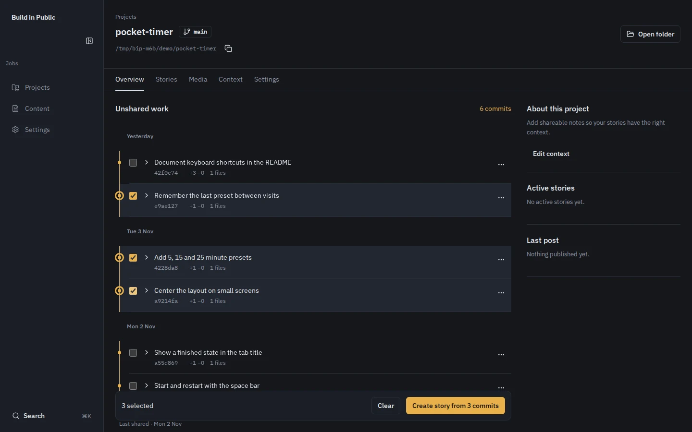
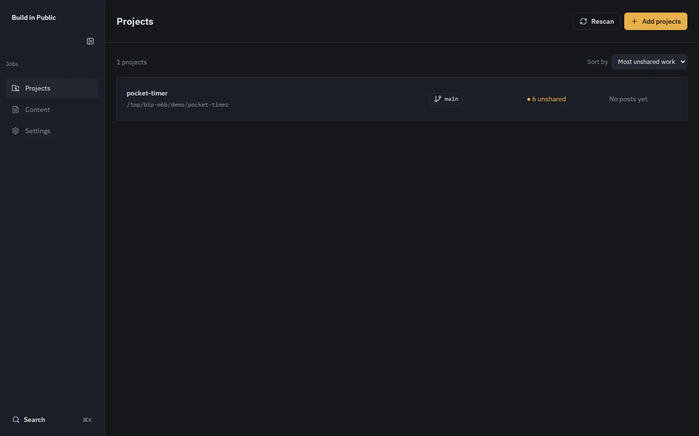
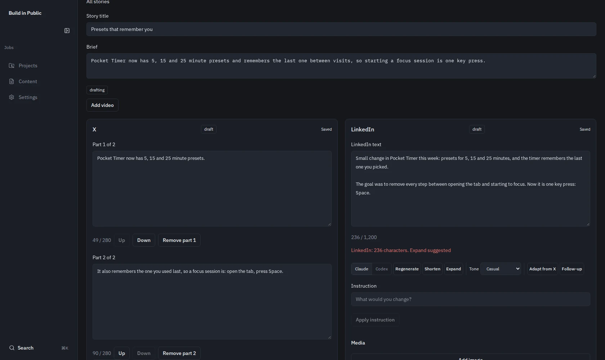
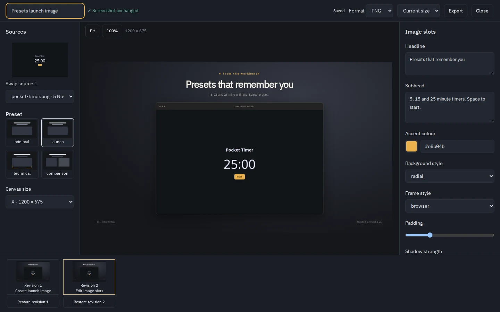

# Build in Public

Build in Public (BIP) is a local web app that turns your recent Git work into posts for X and LinkedIn. It shows which commits you haven't talked about yet, drafts posts grounded in those commits and your project notes, makes polished screenshot images and short edited demo videos, and helps you publish them. It uses the Claude Code and Codex CLIs you already have installed and signed in to, keeps its data on your machine, and never posts anything you haven't approved.



| Projects | Story editor | Image Studio |
|---|---|---|
|  |  |  |

## Quickstart

On Linux, with Node 22 or later, Git and FFmpeg installed:

```sh
git clone https://github.com/SauravSinghChandel/build-in-public.git && cd build-in-public
npx --yes pnpm@10.34.9 install
npx --yes pnpm@10.34.9 exec playwright install chromium
npx --yes pnpm@10.34.9 run doctor
npx --yes pnpm@10.34.9 start
```

`start` builds the app, serves it on `http://127.0.0.1:4310`, prints a one-time session URL and opens it in your browser. Sign in to the agents yourself beforehand: run `claude` once in a terminal, and/or `codex login`.

The commands use `npx pnpm@10.34.9` because, with Ubuntu's packaged Node, `corepack enable` fails with a permission error (it tries to write to `/usr/bin`). If you have corepack set up (for example with Node from nodejs.org, nvm or Homebrew), `corepack enable` and then plain `pnpm install`, `pnpm start` and so on are equivalent (the version is pinned in `package.json`). Write `pnpm run doctor`, not `pnpm doctor`: pnpm has a built-in `doctor` command.

## How it works

1. **Projects.** Add a folder (for example `~/projects`). BIP finds the Git repositories in it and you pick which ones to track. Each project shows how many commits you've made since your last post.
2. **Stories.** On a project's Overview, select commits and choose "Create story". A story is one thing worth sharing. An agent proposes three angles, or you write your own.
3. **Drafts, images, videos.** The agent writes an X post or thread and a LinkedIn post. Edit them yourself or ask for changes (Regenerate, Shorten, Expand, Tone, Adapt, Follow-up, or a free-form instruction); every change is a revision you can restore. Image Studio puts a screenshot into a preset layout. Video Studio records a scripted browser demo and edits it into an MP4 with click zooms and captions.
4. **Publish.** Approve a draft, then copy it into X or LinkedIn yourself (the default), or post it directly through your own connected developer apps. Recording the published URL moves the project's "last shared" marker forward.

You choose Claude or Codex for each agent action.

## Requirements

- Linux. macOS should work but is untested; Windows is not supported. See [docs/platforms.md](docs/platforms.md).
- Node 22 or later, Git, and FFmpeg (including `ffprobe`) on your `PATH`.
- Chromium installed through Playwright (the third quickstart command).
- At least one of [Claude Code](https://docs.claude.com/en/docs/claude-code) (`claude`) or [Codex CLI](https://github.com/openai/codex) (`codex`), installed and signed in with your own account.

`run doctor` checks all of these and prints a fix for anything missing.

## Privacy and what leaves your machine

BIP has no server of its own and sends no telemetry (it also turns off HyperFrames' telemetry). The app listens on 127.0.0.1 only. Data leaves your machine in these cases:

- **Agent calls.** When you run an agent action, BIP starts your `claude` or `codex` CLI, which sends the prompt to Anthropic or OpenAI under your account. The prompt contains the selected commits (messages, stats and capped, redacted diffs), your project's `context.md`, the start of its README, the lines in `private.md` (as a "never mention" list), and, for image and video edits, the composition files and screenshots. Usage counts against your own plan or API key; see [docs/agents.md](docs/agents.md).
- **Social APIs.** Only if you connect an X or LinkedIn account and choose "Post now" or schedule a post.
- **Pages you capture.** Screenshot and demo capture load the URL you enter in a local headless Chromium.

Assisted publishing only opens X or LinkedIn in your browser with the text filled in; BIP itself makes no network call for it.

## Your data lives in `<repo>/.bip/`

Stories, drafts, revisions, images and videos for a project are stored in a `.bip/` folder inside that repository. BIP adds `.bip/` to the repository's `.git/info/exclude`, so `git status` stays clean and nothing is committed by accident.

> **`git clean -fdx`, deleting the repository, or cloning it again deletes `.bip/` and everything in it.** Back it up from the project's Context tab ("Back up now"), or with `node apps/server/dist/cli.js backup --all` after a build.

App-level data (project registry, job queue, agent logs, backups) is in `~/.local/share/build-in-public/` and settings are in `~/.config/build-in-public/config.json`. Set `BIP_HOME` to keep both in a different folder.

## Documentation

- [Architecture](docs/architecture.md): modules, data layout, job runner, rendering
- [Security](docs/security.md): threat model and mitigations
- [Agents](docs/agents.md): how Claude Code and Codex are called, and how to add a provider
- [Extending](docs/extending.md): image presets, video styles, post actions, publishing providers
- [Scheduling](docs/scheduling.md): scheduled posts and the optional systemd timer
- [Platforms](docs/platforms.md): Linux, macOS and Windows notes
- [Licences](docs/licenses.md): dependency licences
- [Contributing](CONTRIBUTING.md), [Code of conduct](CODE_OF_CONDUCT.md), [Security policy](SECURITY.md)

## Licence

[MIT](LICENSE)
